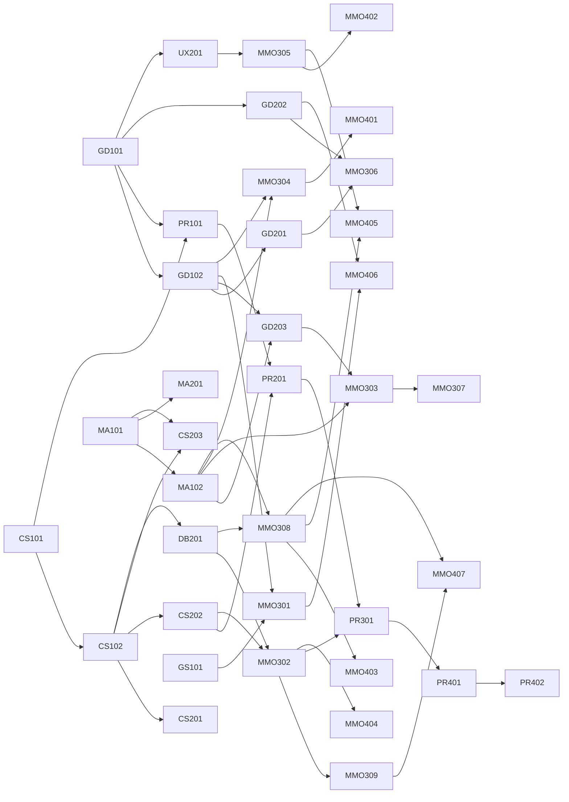

# BSc Game Development — MMORPG Specialization — Program Plan

_Generated from `curriculum.yaml` by `tools/build_plan.py`. Edit the YAML, not this file._

## Structure

- Years 1-2: Core (every student) — design, programming, math, art/audio, production
- Years 3-4: MMORPG specialization — worlds, servers, balance, economies, society, live ops

4 years · 8 semesters · 15 weeks each · 39 courses · 145 credits

### Reference stack

- **math and sims**: Python 3 + Jupyter (numpy, matplotlib) and single-file HTML/JS interactives
- **client**: Godot 4 (C# or GDScript); concepts portable to Unity/Unreal
- **engine course**: C++20
- **server**: C# (.NET 8) reference implementation; Go accepted
- **data**: PostgreSQL + Redis

## Curriculum map

| Sem | Year | Courses |
|---|---|---|
| 1 | 1 | GD101 Introduction to Game Design CS101 Programming for Games I MA101 Mathematics for Games I: Algebra, Functions & Trigonometry GS101 History and Critical Study of Games AR101 Visual Foundations for Games |
| 2 | 1 | GD102 Systems Design and Game Mechanics CS102 Programming for Games II: Structures and Patterns MA102 Mathematics for Games II: Probability and Statistics AU101 Audio for Games PR101 Game Production I: Teams, Scope and the Game Jam |
| 3 | 2 | CS201 Game Engine Architecture MA201 Linear Algebra and Physics for Games GD201 Level and World Design GD202 Narrative and Quest Design UX201 Game UX and Player Psychology |
| 4 | 2 | CS202 Networking Fundamentals for Multiplayer Games CS203 Artificial Intelligence for Games GD203 Combat and Progression Design DB201 Data, Persistence and Telemetry PR201 Studio Project I: Multiplayer Vertical Slice |
| 5 | 3 | MMO301 Virtual Worlds: History, Theory and Design MMO302 MMO Server Architecture MMO303 Game Balance I: Combat and Class Balance MMO304 Virtual Economies I: Faucets, Sinks and Markets MMO305 Social Systems and Online Behaviour |
| 6 | 3 | MMO306 Content Design at Scale: Quests, Dungeons and Raids MMO307 Game Balance II: PvP, Progression and Endgame MMO308 Live Operations, Analytics and Experimentation MMO309 Security, Anti-Cheat and Anti-Bot PR301 MMO Studio Project I: Persistent World Prototype |
| 7 | 4 | MMO401 Virtual Economies II: Markets, Governance and Macro Policy MMO402 Emergent Society, Governance and Ethics MMO403 Business, Monetization and Ethics of Live Games MMO404 Advanced Networked Simulation PR401 Capstone I: Pre-production |
| 8 | 4 | MMO405 Research Methods in Online Games MMO406 Worldbuilding and Lore for Persistent Worlds MMO407 Launch, Scaling and Post-Mortems PR402 Capstone II: Production and Launch |

## Prerequisite graph

## Build status

| Course | Syllabus | Lectures written | Examples built (signature) | Labs | Assessments |
|---|---|---|---|---|---|
| GD101 | stub | 14/14 | 14 (3) | 14 | 5 |
| CS101 | stub | 0/14 | 0 (3) | 0 | 0 |
| MA101 | finished | 14/14 | 14 (4) | 14 | 5 |
| GS101 | stub | 14/14 | 14 (2) | 13 | 4 |
| AR101 | stub | 0/14 | 0 (2) | 0 | 0 |
| GD102 | stub | 14/14 | 14 (3) | 14 | 4 |
| CS102 | stub | 0/14 | 0 (2) | 0 | 0 |
| MA102 | finished | 14/14 | 15 (4) | 14 | 5 |
| AU101 | stub | 0/14 | 0 (2) | 0 | 0 |
| PR101 | stub | 0/14 | 0 (1) | 0 | 0 |
| CS201 | stub | 0/14 | 0 (2) | 0 | 0 |
| MA201 | stub | 0/14 | 0 (2) | 0 | 0 |
| GD201 | stub | 0/14 | 0 (2) | 0 | 0 |
| GD202 | stub | 0/14 | 0 (1) | 0 | 0 |
| UX201 | stub | 7/14 | 0 (2) | 4 | 0 |
| CS202 | stub | 0/14 | 0 (2) | 0 | 0 |
| CS203 | stub | 0/14 | 0 (2) | 0 | 0 |
| GD203 | finished | 14/14 | 14 (3) | 15 | 4 |
| DB201 | stub | 0/14 | 0 (1) | 0 | 0 |
| PR201 | stub | 0/14 | 0 (0) | 0 | 0 |
| MMO301 | stub | 7/14 | 0 (2) | 3 | 0 |
| MMO302 | stub | 0/14 | 0 (2) | 0 | 0 |
| MMO303 | finished | 14/14 | 15 (3) | 14 | 4 |
| MMO304 | finished | 14/14 | 14 (3) | 12 | 4 |
| MMO305 | stub | 3/14 | 0 (2) | 0 | 0 |
| MMO306 | stub | 0/14 | 0 (2) | 0 | 0 |
| MMO307 | stub | 0/14 | 0 (3) | 0 | 0 |
| MMO308 | stub | 0/14 | 0 (2) | 0 | 0 |
| MMO309 | stub | 0/14 | 0 (2) | 0 | 0 |
| PR301 | stub | 0/14 | 0 (0) | 0 | 0 |
| MMO401 | stub | 14/14 | 14 (2) | 14 | 4 |
| MMO402 | stub | 0/14 | 0 (1) | 0 | 0 |
| MMO403 | stub | 0/14 | 0 (2) | 0 | 0 |
| MMO404 | stub | 0/14 | 0 (1) | 0 | 0 |
| PR401 | stub | 0/14 | 0 (0) | 0 | 0 |
| MMO405 | stub | 0/14 | 0 (1) | 0 | 0 |
| MMO406 | stub | 0/14 | 0 (0) | 0 | 0 |
| MMO407 | stub | 0/14 | 0 (1) | 0 | 0 |
| PR402 | stub | 0/14 | 0 (0) | 0 | 0 |

## Course details

### Semester 1 (Year 1)

#### GD101 — Introduction to Game Design
Track: core · Credits: 4 · Prerequisites: none

What a game is, how its parts produce experience, and how designers test ideas cheaply with paper before code.

**Outcomes**

- Describe any game with formal elements (players, objectives, rules, resources, conflict, boundaries, outcome)
- Analyze games with the MDA framework
- Build and iterate a paper prototype using structured playtests
- Write a one-page design and a playtest report

**Weekly topics**

1. What is a game? Definitions (Suits, Salen & Zimmerman, Juul)
2. Formal elements: players, objectives, procedures, rules
3. Resources, conflict, boundaries, outcome
4. MDA: mechanics, dynamics, aesthetics
5. Player experience goals and the 8 kinds of fun
6. Paper prototyping I: cards, dice, boards
7. Playtesting method: observe, don't explain
8. Iteration loops and kill-your-darlings
9. Choice and meaningful decisions (Sid Meier's 'interesting decisions')
10. Chance vs skill; the role of randomness
11. Balance intuition: dominant strategies and how to spot them
12. Feedback: juice, clarity, readability
13. Genres as clusters of mechanics
14. Design documents: one-pagers and pitch
15. Final: paper game showcase and playtest report

**Signature worked examples**

- Tic-tac-toe is solved: map the full game tree and show why it stops being fun
- Monopoly's positive feedback loop: simulate wealth concentration over 50 turns
- Dominant strategy hunt: a broken card game fixed with one rule change

**Core readings**

- Fullerton — Game Design Workshop (4th ed.), ch. 1-7
- Hunicke, LeBlanc, Zubek (2004) — MDA: A Formal Approach to Game Design
- Salen & Zimmerman — Rules of Play, ch. 7-9

**Assessment:** Paper prototype (40%), 3 playtest reports (30%), analysis essay (20%), participation (10%)

#### CS101 — Programming for Games I
Track: core · Credits: 4 · Prerequisites: none

First programming course, taught entirely through small games: variables to game loops to a complete arcade game.

**Outcomes**

- Write, run and debug programs using variables, conditionals, loops and functions
- Explain and implement a fixed-timestep game loop
- Handle input, draw sprites, detect collisions
- Ship a complete small arcade game

**Weekly topics**

1. Programs, variables, types — a text adventure's state
2. Conditionals — room transitions and win/lose
3. Loops — the game loop concept
4. Functions and decomposition
5. Arrays and lists — inventories
6. Dictionaries/maps — item databases
7. Engine intro: scenes, nodes, scripts (Godot)
8. Input handling and movement
9. Delta time and frame-rate independence
10. Collision basics: AABB and circles
11. Game state machines (menu, play, pause, game over)
12. Debugging: breakpoints, logging, rubber-ducking
13. Randomness: spawning and procedural variety
14. Polish pass: sound, particles, screen shake
15. Final: arcade game release

**Signature worked examples**

- Why movement speed doubles on a 120 Hz monitor without delta time — side-by-side interactive
- Fixed vs variable timestep: the 'Fix Your Timestep' accumulator visualized
- AABB overlap test shown as four comparisons on a live drag-and-drop canvas

**Core readings**

- Nystrom — Game Programming Patterns: Game Loop, Update Method
- Fiedler — Fix Your Timestep! (gafferongames.com)

**Assessment:** Weekly exercises (40%), 2 mini-games (30%), final arcade game (30%)

#### MA101 — Mathematics for Games I: Algebra, Functions & Trigonometry
Track: core · Credits: 4 · Prerequisites: none

The math that sits inside every stat sheet and every movement script: functions, curves, trig and vectors.

**Outcomes**

- Model game quantities with linear, polynomial, exponential, logarithmic and rational functions
- Choose a curve shape to produce a desired feel (growth, diminishing returns, caps)
- Use trigonometry for rotation, aiming and circular motion
- Use 2D vectors for movement, direction and distance

**Weekly topics**

1. Functions as machines: input stat, output effect
2. Linear functions and rates (damage per level)
3. Polynomials and quadratic curves (jump arcs)
4. Exponentials: growth and the XP curve
5. Logarithms: 'how many levels until…'
6. Rational functions and asymptotes: A/(A+K)
7. Piecewise functions, caps and floors
8. Interpolation: lerp, inverse lerp, remap
9. Easing curves for animation feel
10. Angles, radians, sin/cos — orbiting and aiming
11. atan2 and turning toward a target
12. 2D vectors: add, scale, magnitude, normalize
13. Dot product: facing, field of view cones
14. Distances and ranges: circles, squared distance trick
15. Final exam + curve-design mini project

**Signature worked examples**

- Armor / (Armor + K): mitigation curve vs effective HP line (League of Legends K=100, WoW K=400+85·level) — the course's anchor example
- RuneScape XP curve: why level 92 is halfway to 99 (verified: 6,517,253 of 13,034,431 XP)
- Diagonal movement bug: why un-normalized WASD is ~41% faster
- Dot product vision cone: stealth guard that 'sees' 60° ahead

**Core readings**

- Dunn & Parberry — 3D Math Primer for Graphics and Game Development, ch. 1-2
- Freya Holmér — Math for Game Devs lecture series (video)

**Assessment:** Problem sets (40%), curve-design project (20%), midterm (15%), final (25%)

#### GS101 — History and Critical Study of Games
Track: core · Credits: 3 · Prerequisites: none

From Senet to MUDs to live-service worlds: how games evolved, and how to read them critically.

**Outcomes**

- Place major games and genres on a historical timeline with causes
- Write a critical close-reading of a game
- Explain how technology, business and culture shaped design

**Weekly topics**

1. Play before computers: board games, sport, ritual
2. Early computer games: Spacewar!, Tennis for Two
3. Arcade era and the coin-op business model
4. Home consoles and the 1983 crash
5. Text adventures and MUD1 (1978): the first virtual world
6. The RPG lineage: D&D to Ultima and Wizardry
7. The PC era: strategy, simulation, the modding scene
8. 3D and the genre explosion
9. Graphical MMOs: Meridian 59, Ultima Online, EverQuest
10. World of Warcraft and the mass-market MMO
11. Free-to-play, mobile, and live service
12. Indie games and the auteur designer
13. Critical frameworks: ludology vs narratology
14. Games and representation
15. Final: critical essay presentations

**Signature worked examples**

- The 1983 crash in numbers: shelf supply vs demand chart (verify figures)
- Timeline explorer: concurrent-user peaks of landmark MMOs (verify each figure)

**Core readings**

- Donovan — Replay: The History of Video Games (selected)
- Bartle — Designing Virtual Worlds, ch. 1 (history)

**Assessment:** Timeline project (25%), 2 close readings (40%), final essay (35%)

#### AR101 — Visual Foundations for Games
Track: core · Credits: 3 · Prerequisites: none

Color, shape, composition and readability for game art — including pixel art and UI legibility.

**Outcomes**

- Apply value, color and shape language to communicate gameplay
- Produce readable sprites and tiles at small sizes
- Critique visual clarity in busy scenes

**Weekly topics**

1. Seeing like an artist: value before color
2. Shape language: circles, squares, triangles
3. Silhouette readability
4. Color theory: hue, saturation, value
5. Palettes and color harmony
6. Pixel art fundamentals
7. Tilesets and seamless tiling
8. Sprite animation: frames and timing
9. Composition and leading the eye
10. Readability in chaos: VFX and telegraphing
11. UI visual hierarchy
12. Accessibility: color-blindness and contrast
13. Art style bibles
14. Pipeline: export, atlases, import settings
15. Final: art portfolio piece

**Signature worked examples**

- Silhouette test: black-fill each character — can you still tell classes apart?
- Color-blind simulator applied to a raid boss telegraph

**Core readings**

- Solarski — Drawing Basics and Video Game Art (selected)

**Assessment:** Weekly studies (50%), style bible (20%), final piece (30%)

### Semester 2 (Year 1)

#### GD102 — Systems Design and Game Mechanics
Track: core · Credits: 4 · Prerequisites: GD101

Games as systems of resources and loops. The foundation for economy, progression and balance later in the degree.

**Outcomes**

- Model a game as stocks, flows and feedback loops
- Diagram systems in Machinations
- Identify positive/negative feedback and predict dynamics
- Design an internal economy for a small game

**Weekly topics**

1. Systems thinking: parts, relationships, emergence
2. Stocks and flows
3. Positive feedback loops (snowballing)
4. Negative feedback loops (rubber-banding)
5. Machinations diagrams I
6. Machinations diagrams II: converters, traders, gates
7. Internal economies: sources, drains, converters
8. Core loops and meta loops
9. Progression systems: skill vs power
10. Emergence vs progression (Juul)
11. Intransitive mechanics: rock-paper-scissors
12. Emergent behavior from simple rules
13. Systems documentation
14. Tuning with spreadsheets
15. Final: system design document + simulation

**Signature worked examples**

- Mario Kart's item distribution as negative feedback (by race position) — simulate lead stability
- Faucets and drains in a tiny town economy: move one slider and watch inflation appear
- Rock-paper-scissors with unequal payoffs: the mixed strategy shifts (interactive payoff matrix)

**Core readings**

- Adams & Dormans — Game Mechanics: Advanced Game Design
- Meadows — Thinking in Systems: A Primer, ch. 1-2

**Assessment:** Machinations models (30%), economy design (30%), final SDD (40%)

#### CS102 — Programming for Games II: Structures and Patterns
Track: core · Credits: 4 · Prerequisites: CS101

Object-oriented and data-oriented thinking, core data structures and the patterns that hold game code together.

**Outcomes**

- Use classes, interfaces and composition appropriately
- Pick data structures by access pattern and cost
- Apply common game programming patterns
- Write testable gameplay code

**Weekly topics**

1. Classes, objects, encapsulation
2. Inheritance vs composition (the 'god class' trap)
3. Interfaces and polymorphism
4. Big-O intuition for game developers
5. Arrays vs linked lists vs hash maps
6. Queues and stacks: undo, command buffers
7. Trees: scene graphs and skill trees
8. Graphs: maps and dialogue
9. Pattern: Component
10. Pattern: Observer / events
11. Pattern: State and State Machine
12. Pattern: Command (input, replay, undo)
13. Data-driven design: stats in JSON/CSV
14. Unit testing gameplay rules
15. Final: data-driven RPG combat module

**Signature worked examples**

- Command pattern replay: record 30 s of inputs and replay them deterministically
- Why a List lookup of 10,000 items stalls a frame vs a Dictionary — live timing chart

**Core readings**

- Nystrom — Game Programming Patterns (Command, Observer, State, Component)

**Assessment:** Labs (40%), pattern project (25%), final module (35%)

#### MA102 — Mathematics for Games II: Probability and Statistics
Track: core · Credits: 4 · Prerequisites: MA101

Loot, crits, drop rates, matchmaking and A/B tests all run on probability. This course makes randomness designable.

**Outcomes**

- Compute probabilities of compound events (drops, crits, combos)
- Use expected value and variance to compare designs
- Model 'until success' processes with the geometric distribution
- Design pseudo-random and pity systems with controlled variance
- Read basic statistics from playtest data

**Weekly topics**

1. Probability basics: sample spaces and events
2. Independent events: the gambler's fallacy in loot
3. Complement rule: chance of at least one drop
4. Expected value: comparing weapons
5. Variance and standard deviation: 'swingy' designs
6. Binomial distribution: crits over a fight
7. Geometric distribution: kills until the drop
8. Dice sums and the normal curve (2d6 vs 1d12)
9. Weighted tables and loot table design
10. Pseudo-random distribution and pity timers
11. Monte Carlo simulation
12. Descriptive statistics for playtests
13. Sampling, confidence and why n=5 lies
14. Intro to hypothesis testing (A/B)
15. Final exam + loot system design

**Signature worked examples**

- 1% drop rate: after 100 kills only ~63% of players have it — and 1 in 20 still lacks it after ~300 kills
- Dota 2 pseudo-random distribution: same average crit rate, far lower streakiness (verify C constants)
- Gacha pity: soft/hard pity changes the expected pulls (Genshin hard pity at 90; verify soft-pity rates)
- 2d6 vs 1d12: same range, completely different feel

**Core readings**

- Schreiber — Game Balance Concepts (blog course), levels 4-5
- Schreiber & Romero — Game Balance (2021), ch. on probability

**Assessment:** Problem sets (35%), Monte Carlo lab (20%), loot design (20%), final (25%)

#### AU101 — Audio for Games
Track: core · Credits: 3 · Prerequisites: none

Sound as feedback and atmosphere: SFX design, adaptive music and implementation with middleware.

**Outcomes**

- Design and implement SFX that communicate game state
- Build adaptive music with layers and transitions
- Mix for clarity in dense scenes

**Weekly topics**

1. What sound does in games: feedback, space, emotion
2. Recording and foley basics
3. Synthesis for SFX
4. Layering and variation (avoid machine-gun effect)
5. Implementation in engine
6. Middleware: FMOD/Wwise events and parameters
7. Spatial audio and attenuation
8. Adaptive music: vertical layering
9. Horizontal re-sequencing and stingers
10. Mixing, ducking, priority
11. UI sound design
12. Audio for MMOs: many players, one mix
13. Accessibility: subtitles and visual sound cues
14. Optimization: voices, memory, streaming
15. Final: sound pass on a game slice

**Signature worked examples**

- The machine-gun effect: same sample x10 vs randomized pitch/volume variants (interactive player)
- Vertical layering: combat intensity slider mixes stems in real time

**Core readings**

- Collins — Game Sound, ch. 1-3

**Assessment:** SFX pack (30%), adaptive music (30%), final sound pass (40%)

#### PR101 — Game Production I: Teams, Scope and the Game Jam
Track: core · Credits: 3 · Prerequisites: GD101, CS101

How games actually get made: small teams, version control, agile, scoping, and finishing.

**Outcomes**

- Use Git in a team workflow
- Scope a project to a fixed timebox
- Run sprints, standups and retrospectives
- Ship a jam game with a team

**Weekly topics**

1. Roles on a game team
2. Git fundamentals and branching
3. Asset workflows and large files (LFS)
4. Scope: MVP, vertical slice, cut lists
5. Agile and Scrum adapted for games
6. Estimation and why it fails
7. Task tracking and definitions of done
8. 48-hour game jam (in class)
9. Jam post-mortem
10. Bug tracking and QA basics
11. Communication and conflict in teams
12. Crunch: causes, costs, alternatives
13. Builds and release checklists
14. Post-mortems as a practice
15. Final: team game release + post-mortem

**Signature worked examples**

- Cone of uncertainty: estimates vs actuals plotted from the class's own jam data

**Core readings**

- Keith — Agile Game Development (selected)
- Game Developer (Gamasutra) post-mortem archive (selected)

**Assessment:** Jam game (30%), final team game (40%), post-mortem (20%), peer review (10%)

### Semester 3 (Year 2)

#### CS201 — Game Engine Architecture
Track: core · Credits: 4 · Prerequisites: CS102

Build a small engine in C++: the loop, memory, entities, rendering hooks, resources and tooling.

**Outcomes**

- Explain the major subsystems of a game engine and their dependencies
- Implement an entity-component-system with cache-friendly storage
- Profile and optimize frame time

**Weekly topics**

1. Engine anatomy and runtime layers
2. C++ for engines: memory, RAII, move semantics
3. Memory allocators: stack, pool, frame
4. The frame: update, render, present
5. Entity-component-system design
6. Cache locality and data-oriented design
7. Resource management and hot reload
8. Rendering pipeline overview
9. Input and event systems
10. Scripting layer integration
11. Physics integration basics
12. Serialization and save files
13. Profiling: CPU, GPU, frame budgets
14. Tools and editors
15. Final: mini engine + demo game

**Signature worked examples**

- Array-of-structs vs struct-of-arrays: iterate 1M entities, visualize cache lines
- 16.6 ms budget pie chart: where a frame's time goes

**Core readings**

- Gregory — Game Engine Architecture (3rd ed.), selected chapters

**Assessment:** Subsystem labs (50%), final engine (50%)

#### MA201 — Linear Algebra and Physics for Games
Track: core · Credits: 4 · Prerequisites: MA101

Vectors, matrices, transforms and Newtonian motion — the math under 3D worlds and movement.

**Outcomes**

- Use matrices for transforms between spaces
- Implement integration for motion and understand its errors
- Build collision detection and response for simple shapes

**Weekly topics**

1. Vectors in 3D, cross product
2. Matrices and linear transformations
3. Transform hierarchies: local and world space
4. Homogeneous coordinates and projection
5. Quaternions for rotation (intuition first)
6. Kinematics: position, velocity, acceleration
7. Numerical integration: Euler vs semi-implicit vs Verlet
8. Forces, mass, drag
9. Collision detection: spheres, AABB, SAT
10. Collision response and impulses
11. Spatial partitioning: grids and quadtrees
12. Raycasting
13. Projectile motion and aiming at moving targets
14. Determinism and floating point
15. Final exam + physics sandbox

**Signature worked examples**

- Explicit Euler orbit spirals outward; semi-implicit stays stable — side-by-side
- Lead-the-target: solve the intercept quadratic for a moving archer target

**Core readings**

- Millington — Game Physics Engine Development (selected)
- Dunn & Parberry — 3D Math Primer, ch. 3-8

**Assessment:** Problem sets (40%), sandbox (30%), final (30%)

#### GD201 — Level and World Design
Track: core · Credits: 4 · Prerequisites: GD102

Spaces that teach, guide and challenge — from single rooms to open worlds and persistent zones.

**Outcomes**

- Plan levels with pacing graphs and critical paths
- Use landmarks, sightlines and affordances to guide players
- Design zones for shared, persistent use by many players

**Weekly topics**

1. Level design as teaching
2. Blockout and greyboxing
3. Flow, pacing and intensity graphs
4. Guiding the player: landmarks, light, weenies
5. Affordances and signposting
6. Combat spaces: cover, lanes, chokepoints
7. Verticality and navigation
8. Environmental storytelling
9. Open-world structure: POI density
10. Hubs, spokes, and gating
11. Shared spaces: designing for many players at once
12. Spawn design and contested resources
13. Metrics: player speed, jump, scale
14. Playtesting levels with heatmaps
15. Final: greybox zone + design doc

**Signature worked examples**

- Walking-speed math: how many seconds between points of interest in a zone (tie to player speed)
- Spawn camping as geometry: sightline heatmap of a respawn point

**Core readings**

- Totten — An Architectural Approach to Level Design

**Assessment:** Blockouts (40%), analysis (20%), final zone (40%)

#### GD202 — Narrative and Quest Design
Track: core · Credits: 3 · Prerequisites: GD101

Interactive storytelling, branching dialogue and quest structures — the building block of RPG content.

**Outcomes**

- Write branching dialogue with manageable scope
- Design quest structures and their reward logic
- Use environmental and emergent narrative

**Weekly topics**

1. Story vs narrative vs plot in games
2. The player as co-author
3. Branching structures and the combinatorial explosion
4. Dialogue systems and state flags
5. Characters and companions
6. Quest anatomy: hook, objective, complication, reward
7. Quest types: kill, fetch, escort, puzzle — and redeeming them
8. Quest chains and zone storytelling
9. Emergent narrative
10. Lore delivery without walls of text
11. Writing for localization
12. Tools: Ink, Yarn Spinner
13. Narrative in multiplayer: shared vs personal story
14. Narrative testing
15. Final: quest chain with branching dialogue

**Signature worked examples**

- Branch explosion calculator: 3 choices per node x depth — why most games fold back

**Core readings**

- Bateman (ed.) — Game Writing: Narrative Skills for Videogames

**Assessment:** Dialogue exercises (40%), quest chain (60%)

#### UX201 — Game UX and Player Psychology
Track: core · Credits: 3 · Prerequisites: GD101

Why players do what they do: motivation, learning, perception and the UX methods to measure it.

**Outcomes**

- Apply Self-Determination Theory and flow to design decisions
- Run usability tests and heuristic evaluations
- Design onboarding and interfaces with cognitive load in mind

**Weekly topics**

1. Perception, attention, memory
2. Cognitive load and UI
3. Flow (Csikszentmihalyi) and difficulty
4. Self-Determination Theory: competence, autonomy, relatedness
5. Reinforcement schedules and their ethics
6. Player motivation models: Bartle, Yee, Quantic Foundry
7. Onboarding and tutorials
8. Usability testing methods
9. Heuristic evaluation for games
10. HUD and information design
11. Accessibility guidelines
12. Surveys and interviews
13. Biometrics and eye-tracking overview
14. UX research reporting
15. Final: UX study of a shipped game

**Signature worked examples**

- Flow channel: plot challenge vs skill for three testers and see who drops out
- Variable ratio vs fixed ratio schedules: response curves (and why loot boxes use one of them)

**Core readings**

- Hodent — The Gamer's Brain
- Ryan, Rigby & Przybylski (2006) — The Motivational Pull of Video Games
- Yee (2006) — Motivations for Play in Online Games

**Assessment:** Usability test (30%), heuristic eval (20%), final study (50%)

### Semester 4 (Year 2)

#### CS202 — Networking Fundamentals for Multiplayer Games
Track: core · Credits: 4 · Prerequisites: CS102

How multiplayer works under latency: sockets, authority, prediction, reconciliation and lag compensation.

**Outcomes**

- Explain latency, jitter, packet loss and bandwidth effects on gameplay
- Implement an authoritative server with client-side prediction and reconciliation
- Implement entity interpolation and lag compensation

**Weekly topics**

1. Networks for game devs: TCP vs UDP
2. Latency, jitter, loss — measure your own
3. Topologies: peer-to-peer, client-server, relay
4. Server authority: never trust the client
5. Serialization and bit packing
6. Reliability over UDP
7. Snapshots and delta compression
8. Client-side prediction
9. Server reconciliation
10. Entity interpolation
11. Lag compensation (rewind hit detection)
12. Deterministic lockstep (RTS)
13. Tick rate and bandwidth budgets
14. Testing under bad networks (netem, clumsy)
15. Final: networked arena prototype

**Signature worked examples**

- Interactive lag lab: toggle prediction/reconciliation/interpolation at 150 ms and watch the ghosts
- Bandwidth budget: 100 players x 20 Hz x bytes per entity — the n-squared wall

**Core readings**

- Gambetta — Fast-Paced Multiplayer (series)
- Bernier (2001) — Latency Compensating Methods in Client/Server In-game Protocol Design (Valve)
- Fiedler — Networking for Game Programmers

**Assessment:** Labs (40%), final prototype (60%)

#### CS203 — Artificial Intelligence for Games
Track: core · Credits: 4 · Prerequisites: CS102, MA101

NPC behavior that is fun rather than optimal: pathfinding, decision making and group tactics.

**Outcomes**

- Implement A* and navigation meshes
- Build NPC behavior with FSMs, behavior trees and utility AI
- Design AI for readability and fairness

**Weekly topics**

1. Game AI vs academic AI: the goal is fun
2. Steering behaviors
3. Graphs and Dijkstra
4. A* and heuristics
5. Navigation meshes
6. Finite state machines
7. Behavior trees
8. Utility AI
9. GOAP
10. Perception systems
11. Group tactics and formations
12. MMO mob AI: leashing, aggro, threat tables
13. Boss AI and scripted encounters
14. Performance: AI LOD, time-slicing
15. Final: NPC ecosystem demo

**Signature worked examples**

- A* vs Dijkstra on the same map: nodes expanded, animated
- Threat table: why a tank's threat multiplier keeps the boss off healers (interactive)

**Core readings**

- Millington — AI for Games (3rd ed.)
- Rabin (ed.) — Game AI Pro (free online chapters)

**Assessment:** Labs (50%), final demo (50%)

#### GD203 — Combat and Progression Design
Track: core · Credits: 4 · Prerequisites: GD102, MA102

The numbers behind RPGs: stats, damage formulas, time-to-kill, XP and power curves, built in spreadsheets.

**Outcomes**

- Design stat systems and damage formulas with predictable properties
- Tune time-to-kill and encounter length
- Build XP and power curves that pace a 40-hour game
- Prototype balance in spreadsheets and simulation

**Weekly topics**

1. Stats as design language
2. Damage formulas: subtractive vs divisive vs multiplicative
3. Mitigation curves and effective HP
4. Time-to-kill (TTK) and time-to-die
5. DPS, burst and sustain
6. Critical hits and variance
7. XP curves: linear, polynomial, exponential
8. Power curves and level scaling
9. Item budgets and stat weights
10. Enemy design by the numbers
11. Spreadsheet balancing workshop
12. Simulation-driven balance
13. Difficulty modes and scaling
14. Horizontal vs vertical progression
15. Final: combat system spec + balance spreadsheet

**Signature worked examples**

- Subtractive armor (damage - armor) makes weak attacks useless; divisive A/(A+K) never does — interactive comparison
- Effective HP is linear in armor: every point is worth the same, the 'diminishing returns' is an illusion of the percent view
- Item budget: price every stat in 'points' and see which item is secretly overbudget

**Core readings**

- Schreiber & Romero — Game Balance (2021)
- Schreiber — Game Balance Concepts, levels 1-3, 6

**Assessment:** Spreadsheet labs (40%), simulation (20%), final spec (40%)

#### DB201 — Data, Persistence and Telemetry
Track: core · Credits: 3 · Prerequisites: CS102

Saving the world: relational modeling of characters and items, transactions, caching, and gameplay telemetry.

**Outcomes**

- Model game entities relationally and query them with SQL
- Use transactions to prevent item duplication
- Instrument a game with telemetry events and build dashboards

**Weekly topics**

1. Why persistence is hard in games
2. Relational modeling: characters, inventories, items
3. SQL I: select, join, aggregate
4. SQL II: indexes and query plans
5. Transactions and ACID
6. Race conditions and the duplication bug
7. NoSQL and key-value stores (Redis)
8. Caching and write-behind
9. Schema migrations in a live game
10. Telemetry design: events and properties
11. Pipelines: collect, store, query
12. Dashboards and KPIs
13. Privacy, GDPR and data retention
14. Backups and disaster recovery
15. Final: persistent inventory service with telemetry

**Signature worked examples**

- The trade dupe: two concurrent trades without a transaction — step-through animation

**Core readings**

- Kleppmann — Designing Data-Intensive Applications, ch. 2, 7

**Assessment:** SQL labs (40%), final service (60%)

#### PR201 — Studio Project I: Multiplayer Vertical Slice
Track: core · Credits: 4 · Prerequisites: PR101, CS202

Cross-discipline teams build a small multiplayer RPG vertical slice — the bridge into the MMO track.

**Outcomes**

- Deliver a playable networked vertical slice as a team
- Integrate design, code, art and audio pipelines

**Weekly topics**

1. Pitch and team formation
2. Pre-production: pillars and scope
3. Technical design document
4. Sprint 1: networking skeleton
5. Sprint 1 review
6. Sprint 2: core combat
7. Sprint 2 review + playtest
8. Sprint 3: content and progression
9. Sprint 3 review
10. Alpha milestone
11. Playtest and telemetry review
12. Sprint 4: polish
13. Beta milestone
14. Release candidate
15. Final: showcase + post-mortem

**Assessment:** Milestones (50%), final slice (30%), post-mortem & peer review (20%)

### Semester 5 (Year 3)

#### MMO301 — Virtual Worlds: History, Theory and Design
Track: mmo · Credits: 4 · Prerequisites: GS101, GD102

The foundational MMO course: what makes a world persistent, shared and alive, from MUD1 to today.

**Outcomes**

- Explain the defining properties of virtual worlds (persistence, shared space, real-time, embodiment)
- Apply player-type models critically
- Analyze design lessons from landmark MMOs and their failures

**Weekly topics**

1. What is a virtual world? Bartle's definition
2. MUD1, MUDs, MOOs and the text era
3. Ultima Online: the simulation dream and its limits
4. EverQuest: the treadmill and the raid
5. World of Warcraft: accessibility and the themepark
6. EVE Online: the single-shard sandbox
7. Themepark vs sandbox
8. Player types (Bartle 1996) and the hero's journey
9. Motivation research beyond Bartle (Yee)
10. Immersion, identity and the avatar
11. Koster's Laws of Online World Design
12. Persistence and time: what should last?
13. Worlds that died: shutdowns and their lessons
14. Designing a world concept
15. Final: world design bible

**Signature worked examples**

- Bartle's interest graph: what happens to a world's population when killers outnumber socializers (simulation of the 1996 dynamics)
- Ultima Online's planned resource ecology: why players emptied it (case study, verify sources)

**Core readings**

- Bartle — Designing Virtual Worlds (free PDF)
- Bartle (1996) — Hearts, Clubs, Diamonds, Spades: Players Who Suit MUDs
- Koster — A Theory of Fun; 'Laws of Online World Design'
- Castronova — Synthetic Worlds, ch. 1-4

**Assessment:** Case studies (40%), player-type critique (20%), world bible (40%)

#### MMO302 — MMO Server Architecture
Track: mmo · Credits: 4 · Prerequisites: CS202, DB201

How thousands of players share one world: zoning, sharding, interest management, persistence and scaling.

**Outcomes**

- Design a server topology for a target concurrency
- Implement area-of-interest management
- Build a persistent, authoritative world server with safe item transactions

**Weekly topics**

1. Scale targets: CCU, messages per second, the n-squared problem
2. Shards, realms, zones, instances, layers
3. Area of interest: grids, radius, hysteresis
4. Zone servers and handoff
5. Tick rate for MMOs vs shooters
6. Simulation authority and anti-cheat by design
7. Persistence strategies: write-through, periodic save, event sourcing
8. Item ownership and transactional integrity
9. Login, character select, gateway services
10. Chat, guild and social services
11. Load testing with bots
12. Single-shard architectures (EVE) and time dilation
13. Cloud deployment and autoscaling
14. Observability: logs, metrics, traces
15. Final: 500-bot load test of a world server

**Signature worked examples**

- Interest management: broadcast-to-all vs grid AOI, messages per tick as players cluster (interactive)
- EVE Online time dilation: slowing the clock to keep a 3,000-player battle consistent (verify figures)

**Core readings**

- Alexander (ed.) — Massively Multiplayer Game Development (selected)
- CCP Games dev blogs on Time Dilation (2011)

**Assessment:** Labs (40%), load test (20%), final server (40%)

#### MMO303 — Game Balance I: Combat and Class Balance
Track: mmo · Credits: 4 · Prerequisites: GD203, MA102

Balancing many classes, roles and encounters at once: mitigation math, the holy trinity, intransitivity, and simulation.

**Outcomes**

- Derive and choose mitigation formulas with eyes open
- Balance roles (tank, healer, DPS) around encounter demands
- Use intransitive design and game theory to avoid dominant builds
- Build a combat simulator to test class balance

**Weekly topics**

1. What 'balanced' means: fairness, viability, diversity
2. Armor and damage mitigation: A/(A+K)
3. Effective HP and effective DPS
4. Stacking mitigation: multiplicative layers
5. The holy trinity: tank, healer, DPS
6. Threat, aggro and control
7. Healing throughput and mana economy
8. Crowd control and diminishing returns
9. Intransitivity and counters
10. Game theory: payoff matrices and Nash equilibria
11. Lanchester's laws and group combat
12. Stat weights and theorycrafting
13. Combat simulators
14. Communicating balance changes (patch notes)
15. Final: 4-class balance pass with simulation evidence

**Signature worked examples**

- Armor / (Armor + K) across League of Legends, Diablo II and WoW — the anchor lesson (built: w02)
- Lanchester's square law: why 10 players beat 8 by far more than 25% (interactive battle)
- CC diminishing returns: 100% -> 50% -> 25% -> immune (WoW-style) and chain-stun math

**Core readings**

- Schreiber & Romero — Game Balance (2021)
- Sirlin — Balancing Multiplayer Competitive Games (GDC 2009)
- Elias, Garfield & Gutschera — Characteristics of Games

**Assessment:** Problem sets (30%), simulator (30%), final balance pass (40%)

#### MMO304 — Virtual Economies I: Faucets, Sinks and Markets
Track: mmo · Credits: 4 · Prerequisites: GD102, MA102

Economics for world designers: scarcity, money supply, inflation, crafting chains and player markets.

**Outcomes**

- Model an MMO economy's faucets, sinks and transformations
- Diagnose inflation and deflation from telemetry
- Design crafting and trade systems with healthy markets

**Weekly topics**

1. Why virtual economies exist: artificial scarcity
2. Value: functional, hedonic, social
3. Faucets, sinks, transformations
4. Money supply per capita and inflation
5. Deflation and hoarding
6. Supply, demand and equilibrium in auction houses
7. Crafting chains and gathering professions
8. Item decay, durability and destruction as sinks
9. Commodity money: when an item becomes currency
10. Market design: auction houses vs player vendors vs barter
11. Real-money trade and gold farming
12. Economic telemetry and dashboards
13. Case studies: EVE, Diablo, RuneScape Grand Exchange
14. Designing an economy from scratch
15. Final: economy spec + simulation

**Signature worked examples**

- Faucet/sink simulator: players join, farm gold, pay repair — watch prices drift (interactive)
- Diablo II's Stone of Jordan becoming de-facto currency (commodity money)
- Diablo III Real-Money Auction House and its 2014 closure (case study)

**Core readings**

- Lehdonvirta & Castronova — Virtual Economies: Design and Analysis (MIT Press, 2014)
- Castronova (2001) — Virtual Worlds: A First-Hand Account of Market and Society on the Cyberian Frontier
- CCP — EVE Online Monthly Economic Reports (selected)

**Assessment:** Models (30%), telemetry lab (20%), final spec (50%)

#### MMO305 — Social Systems and Online Behaviour
Track: mmo · Credits: 4 · Prerequisites: UX201

The social science of MMOs: groups, guilds, trust, status, toxicity and how systems shape behaviour.

**Outcomes**

- Explain how game systems create or erode social ties
- Design grouping, guild and communication systems
- Diagnose and mitigate griefing and toxicity

**Weekly topics**

1. MMOs as societies: social capital (bridging vs bonding)
2. Playing alone together (Ducheneaut et al.)
3. Forced vs voluntary grouping
4. Guilds: formation, lifecycle, leadership
5. Raiding as organization: roles, attendance, loot rules (DKP)
6. Trust and reputation systems
7. Status, prestige and conspicuous display
8. Griefing: typology and design responses
9. Toxicity: research and interventions
10. Communication design: chat, emotes, pings
11. Newcomers and mentoring systems
12. Community management
13. Ethnography of online worlds (Taylor, Boellstorff)
14. Designing for positive social play
15. Final: social system design + research proposal

**Signature worked examples**

- DKP loot systems: zero-sum vs earned-spent, simulate who gets geared first
- Corrupted Blood (WoW, 2005) as an accidental epidemic model (Lofgren & Fefferman 2007)

**Core readings**

- Taylor — Play Between Worlds (2006)
- Ducheneaut, Yee, Nickell & Moore (2006) — 'Alone Together?'
- Steinkuehler & Williams (2006) — Where Everybody Knows Your (Screen) Name
- Kou (2020) — Toxic behaviors in team-based competitive gaming (verify)

**Assessment:** Reading responses (20%), field observation (30%), final design + proposal (50%)

### Semester 6 (Year 3)

#### MMO306 — Content Design at Scale: Quests, Dungeons and Raids
Track: mmo · Credits: 4 · Prerequisites: GD201, GD202

Producing content faster than players consume it: quest hubs, dungeons, raid encounters and repeatable content.

**Outcomes**

- Design group encounters with clear mechanics and telegraphs
- Plan content cadence against consumption rate
- Use procedural and repeatable content responsibly

**Weekly topics**

1. The content treadmill: production vs consumption
2. Quest hubs and zone pacing
3. Dungeon design: trash, bosses, loot
4. Encounter mechanics: tank-and-spank to dance fights
5. Telegraphing and readability
6. Raid design and difficulty tiers
7. Tuning encounters with logs
8. Repeatable content: dailies, dungeons, rotations
9. Procedural and systemic content
10. Player-generated content
11. Events and world bosses
12. Content tooling and pipelines
13. Content budgets and cadence planning
14. Accessibility in group content
15. Final: dungeon with 3 boss encounters

**Signature worked examples**

- Content locust math: 6 months of dev vs hours to clear — the ratio across player percentiles
- Enrage timer: DPS check as a line crossing the boss HP pool (interactive)

**Core readings**

- Blizzard/Square Enix GDC encounter design talks (selected)

**Assessment:** Encounter designs (40%), final dungeon (60%)

#### MMO307 — Game Balance II: PvP, Progression and Endgame
Track: mmo · Credits: 4 · Prerequisites: MMO303

Long-term balance: rating systems, gear treadmills, power creep, catch-up mechanics and endgame design.

**Outcomes**

- Implement and tune Elo/Glicko-style rating systems
- Design endgame progression that resists power creep
- Balance PvP separately from PvE where needed

**Weekly topics**

1. The endgame problem
2. Vertical progression and power creep
3. Horizontal progression
4. Gear treadmills and item level
5. Stat squish: when numbers get too big
6. Catch-up mechanics
7. PvP balance vs PvE balance: split tuning
8. Elo and expected score
9. Glicko and uncertainty; TrueSkill for teams
10. Matchmaking quality vs queue time
11. Seasonal structures and resets
12. Alternative advancement and account progression
13. Meta-game and patch cycles
14. Measuring balance with win rates and pick rates
15. Final: season design with rating simulation

**Signature worked examples**

- Elo expected score: 1/(1+10^(diff/400)) — slider from 0 to 800 rating gap
- Power creep chart: item level over expansions and the stat squish reset (verify WoW figures)
- Queue time vs match fairness trade-off curve

**Core readings**

- Elo — The Rating of Chessplayers
- Glickman — The Glicko System
- Herbrich, Minka, Graepel (2006) — TrueSkill

**Assessment:** Rating lab (30%), progression analysis (30%), final season design (40%)

#### MMO308 — Live Operations, Analytics and Experimentation
Track: mmo · Credits: 4 · Prerequisites: DB201, MA102

Running a world after launch: KPIs, cohorts, retention, A/B tests, patches and events.

**Outcomes**

- Define and compute core live-game KPIs
- Run and analyze A/B tests correctly
- Plan a live-ops calendar

**Weekly topics**

1. What live ops is
2. KPIs: DAU, MAU, stickiness, ARPDAU
3. Cohorts and retention curves
4. Funnels and churn
5. A/B testing: design
6. A/B testing: statistics and pitfalls
7. Segmentation
8. Event design and calendars
9. Patch management and hotfixes
10. Player feedback loops: forums, surveys, polls
11. Community-voted design (Old School RuneScape polls — verify thresholds)
12. Economy monitoring
13. Incident response
14. Sunsetting content and servers
15. Final: live-ops plan + analysis report

**Signature worked examples**

- Retention curves: D1/D7/D30 cohorts plotted — spot the patch that broke onboarding
- Peeking at an A/B test inflates false positives — simulation

**Core readings**

- Seif El-Nasr, Drachen, Canossa (eds.) — Game Analytics (2013)

**Assessment:** Analytics labs (40%), A/B report (20%), live-ops plan (40%)

#### MMO309 — Security, Anti-Cheat and Anti-Bot
Track: mmo · Credits: 3 · Prerequisites: MMO302

Defending a persistent world: exploits, duplication, cheats, bots and account security.

**Outcomes**

- Threat-model an MMO
- Prevent classes of exploits by server design
- Detect bots with behavioral analytics

**Weekly topics**

1. Threat modeling for games
2. Never trust the client
3. Speed hacks and movement validation
4. Duplication exploits and transactional design
5. Memory editing and client integrity
6. Botting economics
7. Bot detection: behavioral features
8. Machine learning for detection (overview)
9. Account security and takeovers
10. Gold sellers and RMT networks
11. Exploit response: rollback vs ban
12. Legal and ethical considerations
13. Bug bounty and disclosure
14. Case studies
15. Final: threat model + detection prototype

**Signature worked examples**

- Speed-hack validation: server-side max-distance-per-tick check with lag tolerance (interactive)
- Bot vs human click timing distributions

**Core readings**

- Hoglund & McGraw — Exploiting Online Games (2007)

**Assessment:** Threat model (30%), labs (30%), final prototype (40%)

#### PR301 — MMO Studio Project I: Persistent World Prototype
Track: mmo · Credits: 4 · Prerequisites: PR201, MMO302

Teams build a small persistent online world with an economy, grouping, and at least one group encounter.

**Outcomes**

- Ship a persistent multiplayer world supporting 50+ concurrent test players

**Weekly topics**

1. Pitch and world pillars
2. Technical architecture review
3. Sprint 1: world server + login
4. Sprint 1 review
5. Sprint 2: combat + mobs
6. Sprint 2 review
7. Sprint 3: economy + crafting
8. Sprint 3 review
9. Alpha: first persistent weekend
10. Telemetry review
11. Sprint 4: social systems
12. Sprint 5: group encounter
13. Beta: open class playtest
14. Stabilization
15. Final: showcase + post-mortem

**Assessment:** Milestones (50%), final world (30%), post-mortem & peer review (20%)

### Semester 7 (Year 4)

#### MMO401 — Virtual Economies II: Markets, Governance and Macro Policy
Track: mmo · Credits: 4 · Prerequisites: MMO304

Advanced economy design and management: monetary policy, market microstructure, player institutions and the in-house economist.

**Outcomes**

- Run agent-based simulations of an MMO economy
- Design interventions (sinks, taxes, rate changes) and predict effects
- Evaluate player-run institutions

**Weekly topics**

1. The in-house economist role
2. Agent-based modeling I
3. Agent-based modeling II
4. Monetary policy tools in games
5. Market microstructure: order books, spreads
6. Manipulation: cornering, cartels
7. Taxes and fees as policy
8. Player banks, loans and scams
9. Regional economies and logistics
10. Scarcity by design: full-loot and destruction
11. Premium currencies and exchange rates
12. Economic shocks: exploits and rollbacks
13. Reading an economic report
14. Intervention design
15. Final: agent-based economy + policy memo

**Signature worked examples**

- EVE PLEX market: how a subscription token links real and virtual money (verify mechanics)
- Transaction-tax tuning: order-book simulation shows volume vs sink trade-off

**Core readings**

- Lehdonvirta & Castronova — Virtual Economies, ch. 9-12
- Guðmundsson (CCP) — EVE economy talks/reports (selected)

**Assessment:** ABM labs (40%), final model + memo (60%)

#### MMO402 — Emergent Society, Governance and Ethics
Track: mmo · Credits: 3 · Prerequisites: MMO305

Player politics, law, moderation and the ethics of running worlds people live in.

**Outcomes**

- Analyze emergent player governance
- Design moderation and justice systems
- Argue ethical positions on world operation

**Weekly topics**

1. Worlds as polities
2. Emergent player government: alliances and councils
3. EVE's Council of Stellar Management (verify)
4. Wars, betrayals and meta-gaming
5. Rules, EULAs and terms of service
6. Moderation at scale
7. Justice systems: reports, reviews, appeals
8. Rights of avatars (Koster 2000)
9. Virtual property and law
10. Addiction, wellbeing and responsible design
11. Minors in online worlds
12. Research ethics in online worlds
13. Shutdown ethics
14. Debates
15. Final: governance design paper

**Signature worked examples**

- The Bank of EVE / scam case: when in-world fraud is 'allowed play' (case study)

**Core readings**

- Koster (2000) — Declaring the Rights of Players
- Boellstorff — Coming of Age in Second Life

**Assessment:** Debate (20%), case analyses (30%), final paper (50%)

#### MMO403 — Business, Monetization and Ethics of Live Games
Track: mmo · Credits: 3 · Prerequisites: MMO308

Business models for persistent worlds and the line between monetization and manipulation.

**Outcomes**

- Model revenue for subscription, F2P and hybrid games
- Identify and avoid dark patterns
- Explain loot box regulation landscape

**Weekly topics**

1. Business models: box, subscription, F2P, hybrid
2. Unit economics: LTV, CAC, ARPPU
3. Premium currencies
4. Cosmetics vs power
5. Battle passes
6. Loot boxes and probability disclosure
7. Regulation: Belgium, Netherlands, China, others (verify current status)
8. Dark patterns
9. Whales and spending distributions
10. Pricing experiments
11. Subscription tokens
12. Publishing, platforms and fees
13. Team and budget planning
14. Pitching to publishers/investors
15. Final: business plan

**Signature worked examples**

- LTV curve: retention x ARPDAU integrated over time (interactive)
- Spending concentration: Lorenz curve of player spend

**Core readings**

- Fields & Cotton — Social Game Design: Monetization Methods and Mechanics

**Assessment:** Models (40%), ethics analysis (20%), business plan (40%)

#### MMO404 — Advanced Networked Simulation
Track: mmo · Credits: 4 · Prerequisites: MMO302

Large battles, seamless worlds and distributed simulation: the frontier of MMO engineering.

**Outcomes**

- Design distributed simulation across many servers
- Optimize replication for massive battles

**Weekly topics**

1. Limits of the zone model
2. Seamless worlds and boundary handoff
3. Spatial partitioning at scale
4. Replication prioritization and relevancy
5. Bandwidth shaping and LOD for networking
6. Massive battles
7. Time dilation revisited
8. Distributed simulation research
9. Server meshing concepts
10. Consistency models
11. Physics in MMOs
12. AI at scale
13. Cost engineering
14. Case study presentations
15. Final: seamless 2-server handoff demo

**Signature worked examples**

- Replication priority: bandwidth budget allocated by distance and relevance (interactive)

**Core readings**

- Selected GDC talks and papers (instructor list)

**Assessment:** Labs (40%), final demo (60%)

#### PR401 — Capstone I: Pre-production
Track: mmo · Credits: 4 · Prerequisites: PR301

Capstone teams pitch, prototype and plan an MMO-scope project.

**Outcomes**

- Produce a greenlit pitch, technical plan and prototype

**Weekly topics**

1. Pitch development
2. Market analysis
3. Pillars and vision
4. Prototype 1
5. Prototype 2
6. Greenlight review
7. Technical design
8. Economy and balance design
9. Content plan
10. Social systems plan
11. Production plan
12. Vertical slice sprint 1
13. Vertical slice sprint 2
14. Pre-production review
15. Final: pre-production package

**Assessment:** Pitch (20%), prototypes (30%), pre-production package (50%)

### Semester 8 (Year 4)

#### MMO405 — Research Methods in Online Games
Track: mmo · Credits: 3 · Prerequisites: MMO305, MMO308

How to produce evidence about online worlds: telemetry analysis, surveys, ethnography and experiments.

**Outcomes**

- Design an ethical study of an online game
- Combine quantitative and qualitative methods

**Weekly topics**

1. Research questions in game studies
2. Quantitative methods overview
3. Telemetry as research data
4. Survey design and validated scales
5. Experiments and quasi-experiments
6. Qualitative methods: interviews
7. Ethnography and participant observation
8. Mixed methods
9. Social network analysis of guilds
10. Ethics and IRB
11. Writing and presenting research
12. Peer review
13. Replication
14. Research presentations
15. Final: research paper

**Signature worked examples**

- Guild social network graph: centrality finds the real leader (not the officer rank)

**Core readings**

- Seif El-Nasr et al. — Game Analytics
- Boellstorff, Nardi, Pearce, Taylor — Ethnography and Virtual Worlds: A Handbook of Method

**Assessment:** Proposal (20%), methods labs (30%), paper (50%)

#### MMO406 — Worldbuilding and Lore for Persistent Worlds
Track: mmo · Credits: 3 · Prerequisites: GD202, MMO301

Building settings that support thousands of simultaneous stories and years of expansions.

**Outcomes**

- Create a setting bible that scales across expansions
- Integrate lore with systems (factions, economy, geography)

**Weekly topics**

1. Setting as system
2. Geography and ecology
3. Factions and conflict
4. History and timelines
5. Cultures, languages, names
6. Religion and myth in fiction
7. Lore delivery in MMOs
8. Player agency vs canon
9. Living world events
10. Expansion planning
11. Retcons and continuity
12. Transmedia
13. Community lore and roleplay
14. Bible workshop
15. Final: world bible

**Core readings**

- Wolf — Building Imaginary Worlds (2012)

**Assessment:** Exercises (40%), bible (60%)

#### MMO407 — Launch, Scaling and Post-Mortems
Track: mmo · Credits: 3 · Prerequisites: MMO308, MMO309

Why MMO launches fail and how some recover: case-based course on launches, relaunches and shutdowns.

**Outcomes**

- Plan a launch with capacity, queue and contingency strategies
- Extract transferable lessons from post-mortems

**Weekly topics**

1. Launch day anatomy
2. Capacity planning and login queues
3. Beta strategies
4. Case: Final Fantasy XIV 1.0 to A Realm Reborn
5. Case: Star Wars Galaxies and the NGE
6. Case: Duplication exploits after launch (New World 2021, verify)
7. Case: Classic/legacy servers
8. Case: EVE's large-scale events
9. Communication during crises
10. Recovery strategies
11. Shutdowns and emulation communities
12. Writing a post-mortem
13. Launch plan workshop
14. Presentations
15. Final: launch plan + post-mortem analysis

**Signature worked examples**

- Login queue math: arrival rate vs admission rate — how long is the queue at hour 3? (interactive)

**Core readings**

- Game Developer post-mortems (selected)

**Assessment:** Case analyses (50%), launch plan (50%)

#### PR402 — Capstone II: Production and Launch
Track: mmo · Credits: 6 · Prerequisites: PR401

Capstone teams produce, test and publicly launch their project with live-ops for the final weeks.

**Outcomes**

- Launch and operate a persistent online game for real players

**Weekly topics**

1. Production sprint 1
2. Production sprint 2
3. Production sprint 3
4. Alpha
5. Closed beta
6. Telemetry and balance review
7. Production sprint 4
8. Open beta
9. Launch
10. Live-ops week 1
11. Live-ops week 2
12. Patch
13. Economy review
14. Post-mortem
15. Final: public showcase

**Assessment:** Milestones (40%), launched game (40%), post-mortem (20%)
